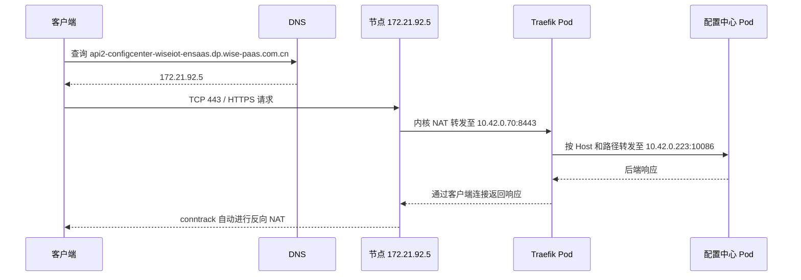

# DP 环境 DNS、Traefik 与请求转发

本文整理前面只读排查 DP 环境得到的结果，以及 Docker Compose、二进制部署和配置中心自动发现的讨论。环境数据来自此前排查记录，Pod IP、名称和端口可能随部署变化；本文编写时未重新连接服务器。

## 1. 一次访问经过哪些环节

以访问配置中心为例：



DNS 负责查 IP；节点网络规则把流量送到 Traefik；Traefik 根据域名、路径选择服务。路由表决定网络包往哪里走，NAT 负责转换地址或端口。

## 2. 域名为什么能解析成局域网 IP

DP 环境此前确认存在以下 DNS 记录：

```text
*.dp.wise-paas.com.cn. 3600 IN A 172.21.92.5
```

因此，不同服务域名可以解析到同一台服务器：

```text
api-configcenter-wiseiot-ensaas.dp.wise-paas.com.cn  → 172.21.92.5
api2-configcenter-wiseiot-ensaas.dp.wise-paas.com.cn → 172.21.92.5
```

此前通过公司 DNS 和公共 DNS 查询，都得到了这个私有 IP。`wise-paas.com.cn` 的权威 DNS 由 Azure DNS 托管。要查看原始记录，应在有权限的 Azure 账号中进入 DNS zone `wise-paas.com.cn`，查找 `*.dp` 的 A 记录；DNS 查询结果本身无法确定所属订阅和资源组。

DP 服务器的解析链路为：

```text
程序 → systemd-resolved（127.0.0.53）→ 公司 DNS（172.21.218.101）
```

公司 DNS 可以递归查询并缓存结果。公开 DNS 记录可以返回私有 IP，但客户端仍需具备到 `172.21.92.5` 的网络路由，例如处于公司网络或连接 VPN。

## 3. kube-dns 有什么用

集群中名为 `kube-dns` 的 Service，对应 CoreDNS：

| 项目 | DP 环境值 |
| --- | --- |
| 命名空间 | kube-system |
| Service IP | 10.43.0.10 |
| DNS 端口 | 53/UDP、53/TCP |
| 指标端口 | 9153/TCP |

它主要供 Pod 解析集群内的服务名，例如：

```text
configcenter.wiseiot.svc.cluster.local → 10.43.112.198
```

外部域名查询则由 CoreDNS 按配置转发给上游 DNS。用户电脑通常查询自己配置的 DNS，不会直接查询集群的 `10.43.0.10`。

## 4. Traefik 是怎么部署的

DP 的 Traefik 是 K3s 通过 Helm 管理的容器服务：

```text
K3s HelmChart → Helm release → Deployment → ReplicaSet → Traefik Pod
```

此前查到的配置：

| 项目 | 值 |
| --- | --- |
| Deployment | kube-system/traefik |
| 镜像 | rancher/mirrored-library-traefik:3.7.4 |
| Pod IP | 10.42.0.70 |
| HTTP 容器端口 | 8000 |
| HTTPS 容器端口 | 8443 |
| Service 类型 | LoadBalancer |
| Service ClusterIP | 10.43.57.150 |
| LoadBalancer IP | 172.21.92.5 |

Traefik Service 端口关系：

| 入口 | Service port | NodePort | Traefik Pod 端口 |
| --- | --- | --- | --- |
| HTTP | 80 | 30439 | 8000 |
| HTTPS | 443 | 32051 | 8443 |

访问节点的 443 并不要求宿主机有一个 Traefik 进程监听 443。内核的 NAT 规则可以先把流量转发到容器，因此仅查看 `ss` 或 `netstat`，不能完整判断入口流量去向。

## 5. ServiceLB、kube-proxy 和 iptables 的分工

ServiceLB 为 LoadBalancer Service 创建负载均衡 Pod。DP 的 `svclb-traefik` Pod 配置了 `hostPort: 80` 和 `hostPort: 443`。

其中，CNI 处理 hostPort 相关规则；kube-proxy 处理 Service 和端点对应的转发规则。这些组件共同建立入口转发，不能把全部宿主机规则都理解为 ServiceLB 直接写入。

DP 此前的 iptables 中，`PREROUTING` 先进入 `KUBE-SERVICES`，再有 CNI hostPort 相关入口。对于目的地址为 `172.21.92.5:443` 的流量，存在直接匹配 LoadBalancer IP 的规则：

```text
172.21.92.5:443
  → KUBE-SERVICES
  → KUBE-EXT-CVG3OEGEH7H5P3HQ
  → KUBE-SVC-CVG3OEGEH7H5P3HQ
  → KUBE-SEP-ZQJQKYFCBRBNWCBP
  → DNAT 10.42.0.70:8443
```

所以，这条路径可以直接进入 Traefik Pod，不必先经过 `svclb-traefik` Pod。集群还存在 CNI hostPort 到 ServiceLB Pod 的另一套规则，实际命中路径取决于目标地址和规则顺序。

参考：[K3s 网络服务与 ServiceLB](https://docs.k3s.io/networking/networking-services)。

## 6. 同一个 IP 怎么找到具体服务

DNS 把多个域名解析到同一个 IP 后，Traefik 使用 HTTP Host 和路径区分请求。HTTPS 入口还涉及 TLS 握手及证书选择，解密后再执行 HTTP 路由。

DP 的 `wiseiot/configcenter` Ingress 规则为：

| Host | Path | 后端 Service | Service 端口 |
| --- | --- | --- | --- |
| api-configcenter-wiseiot-ensaas.dp.wise-paas.com.cn | /，Prefix | configcenter | 10087 |
| api2-configcenter-wiseiot-ensaas.dp.wise-paas.com.cn | /，Prefix | configcenter | 10086 |

这里的 `Prefix` 是 Kubernetes 的路径匹配类型，与项目中“前缀模式表示服务子域名”的命名是两个概念。

Service 的 ClusterIP 为 `10.43.112.198`，此前的 Ready 后端 Pod 为 `10.42.0.223`。Traefik 可以根据 Service 和 EndpointSlice 直接连接 Pod；当前检查结果符合这种方式。启用 `nativeLB` 后，才会使用 Service ClusterIP 作为上游入口。

因此，“Ingress → Service → Pod”描述资源关联时成立，但不一定表示流量逐个经过这些 IP。

此前验证结果：

- `api2-configcenter.../v1/public/configs` 返回 HTTP 200，是配置中心 HTTP API。
- `api-configcenter.../v1/public/configs` 返回 HTTP 404；该域名配置的后端端口是 10087，不能据此认为 DNS 或入口不通。

DP HTTPS 使用默认 TLSStore 指向的证书，公开证书覆盖 `*.dp.wise-paas.com.cn`。此前检查未读取私钥。

参考：[Traefik Ingress 与 nativeLB](https://doc.traefik.io/traefik/reference/routing-configuration/kubernetes/ingress/)。

## 7. NAT 是什么，响应为什么能返回

NAT 是网络地址转换，可以修改网络包的 IP 地址和端口。

| 类型 | 修改内容 | 示例 |
| --- | --- | --- |
| DNAT | 目的 IP 或端口 | 节点 443 → Traefik Pod 8443 |
| SNAT | 来源 IP 或端口 | 内部地址转换成出口地址 |

Linux 的连接跟踪机制 conntrack 会记录连接及 NAT 映射。返回包经过对应的网络路径时，内核根据连接记录自动做反向转换，通常无需单独编写一条反向 NAT 规则。

但完整响应过程还包括反向代理的处理：

```text
客户端 ←连接 A→ Traefik ←连接 B→ 业务服务
```

业务服务通过后端连接把响应交给 Traefik；Traefik 再通过对应的客户端连接返回响应；节点内核处理这一连接所需的反向 NAT。后端连接还可能被复用。

所以，“做反向 NAT 就行”适用于解释 NAT 映射的还原；整条响应链路还依赖代理处理、连接状态和返回路由。NAT 本身不负责按业务域名选择服务。

参考：[Netfilter NAT 与连接跟踪](https://wiki.nftables.org/wiki-nftables/index.php/Performing_Network_Address_Translation_%28NAT%29)。

## 8. 前缀模式和后缀模式如何落到网关

配置中心生成 `publicAddress`，告诉调用方服务的访问地址；Traefik 需要有对应路由，并且能够连接服务的实际后端。

| 项目模式 | publicAddress 示例 | 网关匹配方式 |
| --- | --- | --- |
| 前缀模式，默认 | https://iotedge.example.com | Host |
| 后缀模式 | https://wise.example.com/iotedge/ | Host + 路径 |

后缀模式当前约定：

- `isSuffixMode` 默认为 `false`，设为 `true` 启用后缀模式。
- Host 优先使用非空 `Domain`，否则使用 `GlobalIP`；拼接时不再根据平台区分。
- `isSSL` 决定 HTTP 或 HTTPS，分别使用配置的后缀 HTTP、HTTPS 端口。
- 路径优先使用注册路由的 `UriPrefix`，为空时从 Excel 对应项兜底；都为空则 `publicAddress` 返回空，静默处理。
- 网关是否去掉路径前缀，需要按后端接收路径的约定确定；服务内部的业务路由由服务自己处理。

生成一个 URL 不会自动完成 DNS、端口暴露、TLS 或网关路由配置。这些环节需要共同对应这个访问地址。

## 9. Docker Compose 和二进制部署能否使用 Traefik

两种部署都可以使用 Traefik，区别在入口暴露和后端发现方式。

| 部署方式 | 入口方式 | 后端发现或配置 |
| --- | --- | --- |
| K3s | LoadBalancer Service、ServiceLB 等 | Kubernetes Ingress / EndpointSlice |
| Docker Compose | 发布宿主机 80、443 到 Traefik 容器 | Docker provider 的 labels，或 File / HTTP provider |
| 二进制 | Traefik 进程监听指定端口 | File / HTTP provider 等 |

Compose 中，Traefik 和服务可以通过共享 Docker 网络通信，后端地址使用它可访问的容器地址和端口。Docker 端口发布负责把宿主机入口流量送进容器。

二进制部署中，Traefik 可以转发到本机或其他机器的服务监听地址。`127.0.0.1` 只适用于与 Traefik 处于同一网络命名空间的服务；容器里的回环地址指向容器自身。

参考：[Docker 端口发布](https://docs.docker.com/engine/network/port-publishing/)、[Traefik Docker provider](https://doc.traefik.io/traefik/reference/install-configuration/providers/docker/)。

## 10. 配置中心注册后，能否自动生成 Traefik 路由

可以实现。这属于基于服务注册的自动发现，需要增加配置中心与 Traefik 的对接。以下是讨论方案，尚未作为本次 Wiki 工作开发或部署。


必须分别提供：

| 数据 | 用途 |
| --- | --- |
| publicAddress | 生成客户端入口的 Host、路径规则 |
| router.Address | 作为 Traefik 实际连接的后端地址 |

不能直接把 `publicAddress` 当成上游地址，否则可能再次指向网关，造成循环转发。注册的后端地址也必须能从 Traefik 所在网络访问。

可以新增一个接口，例如 `/v1/traefik/config`，返回 Traefik 标准动态配置的完整快照。这个路径是方案示例，当前不能直接调用。

同机二进制部署的 HTTP provider 静态配置示例：

```yaml
providers:
  http:
    endpoint: "http://127.0.0.1:10086/v1/traefik/config"
    pollInterval: "2s"
```

HTTP provider 拉取的是 Traefik 动态配置，不能直接指向现有服务列表接口。接口输出需要同步反映新增、更新、注销和过期；对于空 `publicAddress` 的注册项，可以跳过其公网路由。

参考：[Traefik HTTP provider](https://doc.traefik.io/traefik/reference/install-configuration/providers/others/http/)。

## 11. 服务器上如何只读检查

以下命令在 DP 服务器执行，仅查询配置或规则。若当前用户需要提权，可在命令前使用 `sudo -n`。不包含修改、重启或部署操作。

### DNS

```bash
dig @172.21.218.101 api2-configcenter-wiseiot-ensaas.dp.wise-paas.com.cn A
dig @172.21.218.101 '*.dp.wise-paas.com.cn' A
resolvectl status
```

### Kubernetes 入口和后端

```bash
sudo -n /usr/local/bin/kubectl --kubeconfig=/etc/rancher/k3s/k3s.yaml -n kube-system get svc traefik -o yaml
sudo -n /usr/local/bin/kubectl --kubeconfig=/etc/rancher/k3s/k3s.yaml -n kube-system get deploy traefik -o yaml
sudo -n /usr/local/bin/kubectl --kubeconfig=/etc/rancher/k3s/k3s.yaml -n kube-system get pods -o wide
sudo -n /usr/local/bin/kubectl --kubeconfig=/etc/rancher/k3s/k3s.yaml -n wiseiot get ingress configcenter -o yaml
sudo -n /usr/local/bin/kubectl --kubeconfig=/etc/rancher/k3s/k3s.yaml -n wiseiot get svc configcenter -o yaml
sudo -n /usr/local/bin/kubectl --kubeconfig=/etc/rancher/k3s/k3s.yaml -n wiseiot get endpointslices -l kubernetes.io/service-name=configcenter -o yaml
```

### 节点 NAT 规则

```bash
sudo -n iptables -t nat -S PREROUTING
sudo -n iptables -t nat -S KUBE-SERVICES
sudo -n iptables-save -t nat | rg 'traefik|CNI-HOSTPORT|10\.42\.0\.70|10\.43\.57\.150'
```

从 `KUBE-SERVICES` 命中的 `-j` 目标继续查询，例如：

```bash
sudo -n iptables -t nat -S KUBE-EXT-CVG3OEGEH7H5P3HQ
sudo -n iptables -t nat -S KUBE-SVC-CVG3OEGEH7H5P3HQ
sudo -n iptables -t nat -S KUBE-SEP-ZQJQKYFCBRBNWCBP
```

链名和 Pod IP 以现场结果为准。查看规则能解释配置的转发路径；判断一次请求实际命中了哪条规则，还需结合计数器或抓包等证据。
